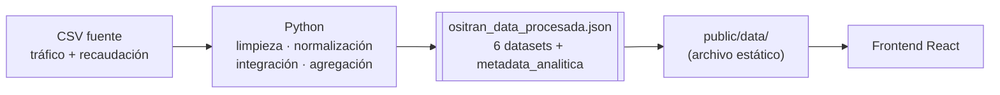
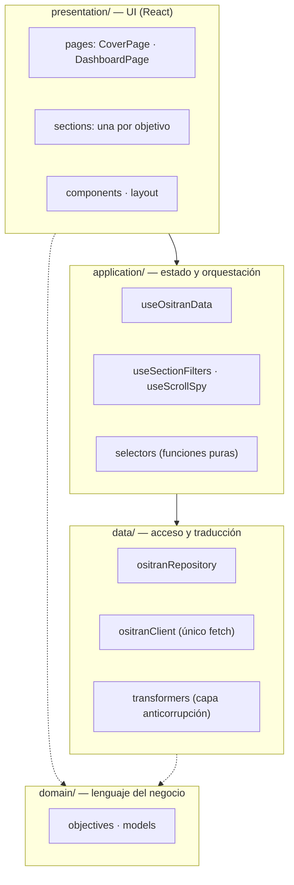
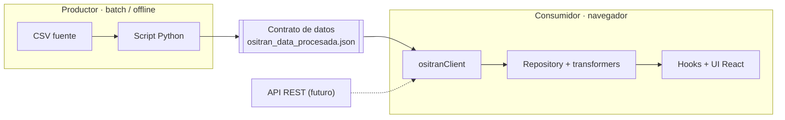
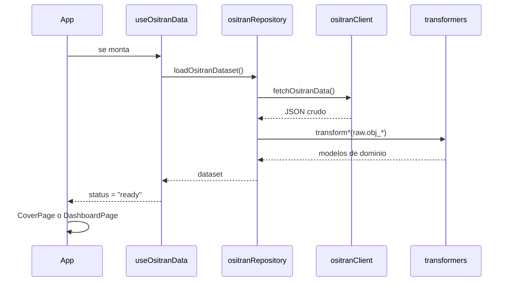

🔒 Nota de confidencialidad: El código fuente del MVP se mantiene en un repositorio privado por contener lógica sensible, reglas de negocio y de gobernabilidad de modelos. Esta sección expone en detalle la arquitectura de software, el diseño analítico y las decisiones de ingeniería implementadas.

# 📊 Sistema

 OSITRAN · Tráfico de pasajeros y recaudación aeroportuaria

Un Producto de Datos (Data Product)  que analiza cómo se movieron los pasajeros y cómo se repartió la recaudación regulada entre 2019 y 2026 en los aeropuertos supervisados por OSITRAN. Cruza tráfico mensual, ingresos por concesionaria y rentabilidad por terminal, construida con React y una arquitectura en capas inspirada en Clean Architecture y DDD.

---

## 1. Descripción del proyecto

El proyecto responde una pregunta concreta: **cuando el tráfico aéreo se recupera, ¿la recaudación se recupera igual, y para todos por igual?**

Se organiza en una portada y seis objetivos analíticos, cada uno con su visualización y filtros:

| Objetivo                           | Pregunta                                                   | Visualización         | Filtros                            |
| ---------------------------------- | ---------------------------------------------------------- | --------------------- | ---------------------------------- |
| **OBJ 1.1** Recuperación           | ¿Cómo evolucionó el tráfico anual por tipo de pasajero?    | Barras apiladas       | Rango de años                      |
| **OBJ 1.2** Estacionalidad         | ¿Qué patrón mensual tiene la recaudación?                  | Línea                 | Rango de años (compartido con 1.2) |
| **OBJ 2.1** Correlación            | ¿Más pasajeros implica más recaudación?                    | Dispersión            | Grupo de aeropuertos               |
| **OBJ 2.2** Estructura de ingresos | ¿De qué rubros viene la recaudación?                       | Barras de composición | Entidad                            |
| **OBJ 3.1** Rentabilidad           | ¿Qué aeropuertos rinden más por pasajero?                  | Ranking de barras     | Top N, incluir hub                 |
| **OBJ 3.2** Concesionarias         | ¿Cómo se reparte tráfico vs. recaudación entre operadores? | Barras pareadas       | — (solo 3 entidades)               |

---

## 2. Procesamiento previo de la información (CSV → Python → JSON)

La aplicación **no procesa archivos CSV**. El trabajo pesado ocurre antes,
fuera del navegador, y entrega un único archivo ya agregado.



### 2.1 Etapas del procesamiento

> Esta sección describe el pipeline **según lo que se puede verificar en el
> JSON resultante**. Los nombres exactos de los CSV de origen y las reglas de
> limpieza aplicadas en el script de Python no forman parte de este
> repositorio; completar donde se indica.

1. **Ingesta**: lectura de los CSV de origen. *(Completar: nombres de archivo, periodo y fuente OSITRAN.)*
2. **Normalización**: columnas en `snake_case` (`nro_pasajeros`, `tipo_ingreso`, `rubro_ingreso`), el mes como texto con cero a la izquierda (`"01"`…`"12"`) y nombres de aeropuerto en mayúsculas.
3. **Integración**: tráfico y recaudación quedan unidos por año, mes y aeropuerto (el dataset `obj_2_1` trae ambas métricas en cada fila).
4. **Agregación por objetivo**: un dataset por cada visualización (tabla siguiente).
5. **Metadata analítica**: cobertura temporal y percentiles de tráfico y recaudación.
6. **Exportación**: un solo JSON, copiado a `public/data/`.

### 2.2 Estructura del JSON (el contrato de datos)

| Clave                                      | Filas | Granularidad                      | Campos                                                                    |
| ------------------------------------------ | -----:| --------------------------------- | ------------------------------------------------------------------------- |
| `obj_1_1_estacionalidad_lineas_multiserie` | 89    | año × mes                         | `año`, `mes_numero`, `nro_pasajeros`                                      |
| `obj_1_2_interanual_barras_apiladas`       | 24    | año × tipo de pasajero            | `año`, `tipo_de_pasajero`, `nro_pasajeros`                                |
| `obj_2_1_correlacion_scatter_plot`         | 1 802 | año × mes × aeropuerto            | `año`, `mes_numero`, `aeropuerto`, `nro_pasajeros`, `recaudación`         |
| `obj_2_2_estructura_ingresos_treemap`      | 71    | entidad × tipo de ingreso × rubro | `entidad`, `tipo_ingreso`, `rubro_ingreso`, `recaudación`                 |
| `obj_3_1_rentabilidad_ranking_barras`      | 36    | aeropuerto                        | `aeropuerto`, `recaudación`, `nro_pasajeros`, `ingreso_promedio_pasajero` |
| `obj_3_2_desempeno_concesionarias_radar`   | 3     | entidad (CORPAC, LAP, OTROS)      | `entidad`, `recaudación`, `nro_pasajeros`                                 |
| `metadata_analitica`                       | —     | —                                 | `cobertura_temporal` (2019-2026), percentiles de tráfico y recaudación    |

### 2.3 Calidad de datos y limitaciones conocidas

Estos puntos se verificaron contra el JSON y condicionan la lectura de los gráficos. Conviene resolverlos en el script de Python, no en el frontend.

| #   | Hallazgo                                                                                                            | Evidencia                                                                                                                                                                                                                            | Efecto en la app                                                                                                                                         |
| --- | ------------------------------------------------------------------------------------------------------------------- | ------------------------------------------------------------------------------------------------------------------------------------------------------------------------------------------------------------------------------------ | -------------------------------------------------------------------------------------------------------------------------------------------------------- |
| 1   | **Los pasajeros no tienen granularidad mensual.** El total anual está cargado en enero y el resto de meses en 0.    | Las 263 filas con pasajeros > 0 de `obj_2_1` caen todas en el mes `01`; la suma por año coincide exactamente con `obj_1_2` (2019: 38 455 360 en ambos). Lo mismo ocurre en `obj_1_1`.                                                | OBJ 1.1 usa la **recaudación** mensual (sí es granular). El eje X de OBJ 2.1 se rotula "promedio por registro", no "por mes".                            |
| 2   | **`NO PRECISA` no es un aeropuerto.** Es recaudación no asignada a un terminal: 101 filas, 0 pasajeros, S/ 167.2 M. | `obj_2_1`                                                                                                                                                                                                                            | `airportTransformer` lo excluye de las vistas por aeropuerto (35 aeropuertos, no 36). Su recaudación sí cuenta en los totales por rubro y concesionaria. |
| 3   | **17 aeropuertos "sin recaudación registrada"**, no necesariamente con recaudación cero.                            | Casi todos tienen entre 2 y 8 filas (típicamente una por año, en enero), lo que es consistente con terminales presentes en la fuente de tráfico y ausentes en la de recaudación. Excepción: Andahuaylas (83 filas). Incluye a Cusco. | Se muestran como grupo `cero`, rotulado "sin recaudación registrada". La causa no está demostrada.                                                       |
| 4   | **`ingreso_promedio_pasajero` no se reproduce con sus propios insumos.**                                            | En `obj_3_1`, `recaudación ÷ nro_pasajeros` da S/ 16.64 para Jorge Chávez; el archivo trae 0.0935. El orden del ranking también cambia (recalculado, Jorge Chávez queda primero, no Pisco).                                          | OBJ 3.1 grafica el valor del archivo **tal cual**. Hay que confirmar la fórmula en el script antes de usar el ranking para conclusiones.                 |
| 5   | **2026 es un año parcial.**                                                                                         | 89 meses = 2019-01 a 2026-05.                                                                                                                                                                                                        | `markPartialYears` lo marca a partir de los meses presentes en la serie de recaudación.                                                                  |
| 6   | **Los titulares editoriales citan cifras fijas** ("−68 %", "43 M").                                                 | Textos en `presentation/sections/`                                                                                                                                                                                                   | Los gráficos y los KPIs de la portada sí se calculan desde el JSON; los titulares hay que revisarlos a mano si el JSON cambia.                           |

---

## 3. Arquitectura del sistema (Clean Architecture & DDD)

Es una arquitectura en cuatro capas con **regla de dependencia hacia adentro**: la UI conoce los hooks, los hooks conocen el repositorio, y nada de lo interno conoce React ni recharts.



### 3.1 Responsabilidad de cada capa

| Capa            | Contiene                                             | Puede depender de         | No debe saber                                                             |
| --------------- | ---------------------------------------------------- | ------------------------- | ------------------------------------------------------------------------- |
| `domain/`       | Catálogo de objetivos y modelos documentados (JSDoc) | nada                      | React, fetch, forma del JSON                                              |
| `data/`         | Cliente, repositorio y transformadores               | `domain/`                 | React, filtros, componentes                                               |
| `application/`  | Hooks de estado y selectores puros                   | `data/`                   | JSX, recharts                                                             |
| `presentation/` | Páginas, secciones y componentes                     | `application/`, `domain/` | `fetch`, nombres de campo del JSON crudo (`nro_pasajeros`, `mes_numero`…) |

### 3.2 Estructura de carpetas

```
public/data/                    dataset de OSITRAN (JSON estático)

src/
├── domain/
│   ├── objectives.js             catálogo de los 6 objetivos
│   └── models.js                 formas de dato (JSDoc)
├── data/
│   ├── ositranClient.js          único fetch() del proyecto
│   ├── ositranRepository.js      orquesta fetch + transformers
│   └── transformers/             JSON crudo -> modelo de dominio
│       ├── trafficTransformer.js
│       ├── revenueTransformer.js
│       ├── airportTransformer.js
│       ├── incomeTransformer.js
│       └── concessionTransformer.js
├── application/
│   ├── useOsitranData.js         carga + estado loading/ready/error
│   ├── useSectionFilters.js      estado de todos los filtros
│   ├── useScrollSpy.js           sección activa + scroll
│   └── selectors.js              (dataset, filtros) -> subconjunto; KPIs de portada
├── presentation/
│   ├── components/               Section, Chip, ChartFrame, Legend…
│   ├── layout/NavBar.jsx
│   ├── sections/                 una por objetivo
│   └── pages/                    CoverPage, DashboardPage
├── styles/tokens.js              paleta, tipografía, estilos de eje
├── utils/format.js               fmt, fmtM, fmtSoles
└── App.jsx                       vista (portada/dashboard) + carga de datos

scripts/
├── smoke-test.jsx                render de CoverPage y DashboardPage con datos reales
└── run-smoke-test.mjs            lo bundlea con esbuild y lo ejecuta en Node
```

---

## 4. Stack tecnológico

| Capa                 | Tecnología                                        | Versión                   | Rol                                                           |
| -------------------- | ------------------------------------------------- | ------------------------- | ------------------------------------------------------------- |
| Procesamiento previo | **Python**                                        | —                         | Limpieza, integración y agregación de los CSV; genera el JSON |
| Interfaz             | **React**                                         | ^18.3.1                   | Componentes y hooks                                           |
| Gráficos             | **Recharts**                                      | ^2.12.7 (resuelve 2.15.4) | Barras, líneas y dispersión sobre SVG                         |
| Build y dev server   | **Vite** + `@vitejs/plugin-react`                 | ^5.4 / ^4.3               | HMR en desarrollo, bundle de producción                       |
| Lenguaje             | **JavaScript (ES modules)** + JSDoc               | —                         | Sin TypeScript; los modelos se documentan con `@typedef`      |
| Estilos              | Estilos en línea + tokens (`styles/tokens.js`)    | —                         | Sin framework CSS                                             |
| Tipografía           | Google Fonts: Space Grotesk, IBM Plex Sans / Mono | —                         | Cargadas desde `index.html`                                   |
| Verificación         | **esbuild** + `react-dom/server`                  | esbuild ^0.28             | `npm run test:smoke`                                          |
| Datos en runtime     | JSON estático servido por Vite                    | —                         | Sin backend                                                   |

---

## 5. Arquitectura desacoplada (Decoupled Architecture)

Productor y consumidor **no se conocen**: solo comparten un contrato, el esquema del JSON. El productor corre una vez (batch, fuera de línea); el consumidor corre en el navegador.




---

## 6. Capa de consumo y orquestación del frontend




## 7. Decisiones de storytelling

Basadas en *Storytelling with Data*:

- **Un insight por sección**, con el titular como conclusión.
- **Color con propósito**: gris/azul como contexto; cian, ámbar y rojo solo donde está la historia.
- **Estética de panel de radar** (fondo oscuro, cifras en monoespaciado), coherente con el dominio aeronáutico.
